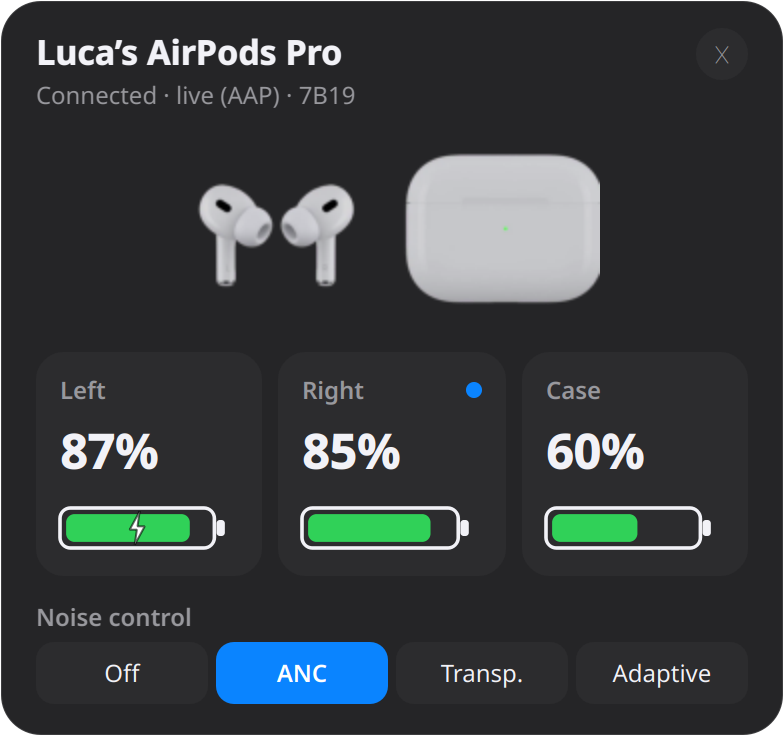
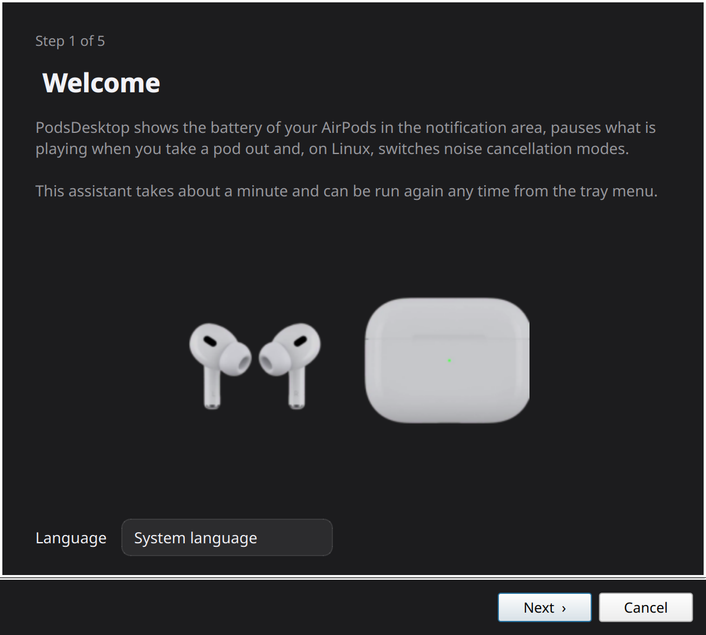
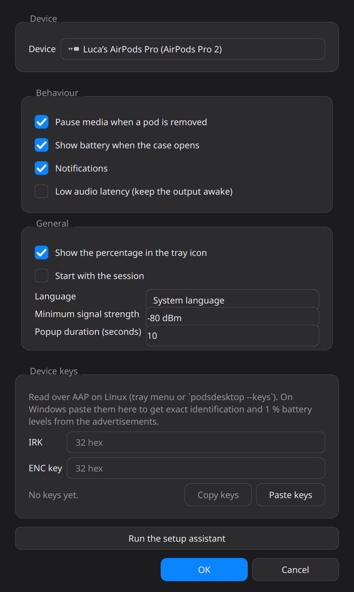

# Instalare PodsDesktop / Installing PodsDesktop

*(English below.)*

<p align="center">
  
  
</p>

## Windows 10 / 11

1. Descarcă **PodsDesktop-Setup.exe** din pagina de release:
   https://github.com/Excusemymanners/PodsDesktop/releases/latest
2. Pornește instalatorul. Windows SmartScreen va spune „Windows protected your PC”, pentru că
   programul nu are semnătură comercială: apasă **More info**, apoi **Run anyway**.
3. În instalator bifează, dacă vrei, **Start PodsDesktop when I sign in** (pornire automată) și
   **Finish**. La final se deschide aplicația cu asistentul de configurare.
4. Pairează AirPods-urile cu Windows, dacă nu sunt deja: *Settings → Bluetooth & devices → Add device
   → Bluetooth*, deschide capacul carcasei și ține apăsat butonul de pe spate până clipește alb.
5. În asistent (imaginea de mai sus): alege limba, confirmă că Bluetooth-ul e pornit, alege
   AirPods-urile din listă, bifează opțiunile, **Gata**. Iconița apare în zona de notificare, lângă ceas (poate fi ascunsă sub
   săgeata `^`; trage-o în bara vizibilă dacă vrei să o vezi mereu).

Varianta portabilă: **PodsDesktop.exe** (fără instalare). Pornește-l de oriunde; setările se țin în
`%APPDATA%\PodsDesktop`.

Cerințe: un adaptor Bluetooth cu **Bluetooth Low Energy** (orice adaptor 4.0 sau mai nou; cele din
laptopuri sunt toate bune). Fără BLE nu se primesc anunțurile căștilor și nu apare bateria.

Ce nu există pe Windows: schimbarea modului de zgomot (ANC/Transparență) și bateria exactă în timp
real. Acestea trec prin canalul AAP (L2CAP), pe care stiva Bluetooth a Windows-ului nu îl dă
programelor obișnuite; ar fi nevoie de un driver de kernel semnat. Poți obține în schimb
identificarea exactă și procentele la 1% din anunțuri lipind în *Setări → Cheile dispozitivului*
cheile citite pe un Linux (vezi mai jos).

## Linux (Fedora, Ubuntu, Debian, Arch, Mint…)

### Varianta 1: binarul gata făcut

```bash
curl -L -o ~/PodsDesktop https://github.com/Excusemymanners/PodsDesktop/releases/latest/download/PodsDesktop-linux-x86_64.bin
chmod +x ~/PodsDesktop
~/PodsDesktop
```

Merge pe distribuții cu glibc 2.35 sau mai nou (Ubuntu 22.04+, Fedora 36+, Debian 12+). Pentru
pornire automată și intrare în meniu, bifează „Pornește odată cu sesiunea” în asistent; intrarea în
meniu o face `packaging/install-linux.sh` din varianta 2.

### Varianta 2: din surse (cu intrare în meniu și comanda `podsdesktop`)

```bash
sudo dnf install python3 git        # Fedora;   Ubuntu/Debian: sudo apt install python3 python3-venv git
git clone https://github.com/Excusemymanners/PodsDesktop.git
cd PodsDesktop
./packaging/install-linux.sh
podsdesktop
```

Scriptul face un mediu Python în `~/.local/share/podsdesktop`, comanda `podsdesktop` în
`~/.local/bin` și intrarea „PodsDesktop” în meniul de aplicații. Nu cere root.

### Primii pași

1. Pairează AirPods-urile din setările Bluetooth ale sistemului (KDE: *Setări → Bluetooth*;
   GNOME: *Settings → Bluetooth*), cu capacul deschis și butonul carcasei ținut apăsat.
2. Pornește `podsdesktop`. La prima pornire apare asistentul: limbă, Bluetooth, alegerea
   căștilor, opțiuni. Dacă e o singură pereche Apple pairată, e aleasă automat.
3. Conectează căștile (din meniul din tray, **Conectează**, sau punându-le în urechi). Aplicația
   deschide canalul AAP: baterie exactă, detecție în ureche, moduri de zgomot în fereastră și în
   meniu. La prima conectare citește și cheile dispozitivului (primești o notificare); de atunci
   căștile sunt recunoscute exact chiar și printre alte AirPods.
4. Deschide carcasa lângă laptop: apare fereastra cu bateria. Clic pe iconiță o arată oricând.

Cerințe: BlueZ 5.50 sau mai nou (orice distribuție din 2019 încoace), PipeWire sau PulseAudio
pentru pauză/reluare media (MPRIS). Nu e nevoie de root, de patch-uri de kernel sau de
`Experimental = true` în BlueZ.

### Cheile pentru Windows

<p align="center"></p>

Pe Linux, după prima conectare, deschide *Setări…* din tray → **Cheile dispozitivului → Copiază
cheile**, sau rulează `podsdesktop --keys` și copiază cele două șiruri din
`~/.config/podsdesktop/settings.json` (`irk` și `enc_key`). Pe Windows: *Setări… → Cheile
dispozitivului → Lipește cheile*. Cheile sunt ale AirPods-urilor, nu ale calculatorului, deci
aceleași chei merg pe oricâte calculatoare.

## Linie de comandă (ambele sisteme)

```
podsdesktop --battery          Luca’s AirPods Pro  Left: 87% ⚡  Right: 85%  Case: 60%  [AAP]
podsdesktop --json             starea completă, pentru scripturi sau bare de stare
podsdesktop --watch --battery  afișează la fiecare schimbare
podsdesktop --scan             toate anunțurile Apple din jur, cu verdictul „ours / maybe / foreign”
podsdesktop --devices          dispozitivele Apple pairate (* = cel ales)
podsdesktop --mode anc         off | anc | transparency | adaptive (Linux, căști conectate)
podsdesktop --setup            aplicația cu asistentul de configurare
```

Pe Windows, din folderul de instalare: `PodsDesktop.exe --battery` (sau `--json`, `--scan`).

## Probleme frecvente

| Simptom | Cauză probabilă și rezolvare |
|---|---|
| Asistentul nu găsește nicio pereche | Căștile nu sunt pairate cu calculatorul. Pairează-le din setările sistemului cu capacul deschis și butonul apăsat, apoi **Reîmprospătează**. |
| Iconița e goală, cu liniuță | Nu se primește nimic: căștile sunt în carcasă cu capacul închis sau departe. Deschide capacul lângă calculator. |
| Nu apare fereastra la deschiderea carcasei | Verifică în *Setări* că „Arată bateria la deschiderea carcasei” și „Ascultă anunțurile BLE” sunt bifate; pe Windows, adaptorul trebuie să suporte BLE. |
| Pe Linux nu apar modurile de zgomot | Căștile nu sunt conectate (canalul AAP se deschide doar cu căștile conectate), sau modelul nu are ANC. |
| Se afișează AirPods-urile altcuiva | Până la citirea cheilor identificarea e aproximativă. Conectează căștile o dată pe Linux (sau lipește cheile pe Windows). |
| Muzica nu se oprește la scoaterea căștii | Bifează „Pauză la scoaterea unei căști din ureche”; pe Linux playerul trebuie să expună MPRIS (Spotify, Firefox, Chrome, VLC, mpv o fac). |
| Jurnal | Linux: `~/.local/state/podsdesktop/podsdesktop.log`; Windows: `%LOCALAPPDATA%\PodsDesktop\podsdesktop.log`. Pornește cu `-v` pentru detalii. |

---

# English

## Windows 10 / 11

1. Download **PodsDesktop-Setup.exe** from https://github.com/Excusemymanners/PodsDesktop/releases/latest
2. Run it. SmartScreen will warn because the build is not commercially signed: **More info → Run anyway**.
3. Optionally tick **Start PodsDesktop when I sign in**, then **Finish**. The app starts with the setup assistant.
4. Pair the AirPods in *Settings → Bluetooth & devices* if you have not yet (lid open, hold the case button until the light blinks white).
5. In the assistant: language, Bluetooth check, pick the AirPods, options, **Finish**. The icon sits in the notification area (possibly under the `^` overflow arrow).

**PodsDesktop.exe** is the portable build (no installer; settings in `%APPDATA%\PodsDesktop`).
A Bluetooth Low Energy capable adapter (4.0+) is required for the battery advertisements.

Not available on Windows: noise-control switching and live 1 % battery over AAP. The Microsoft
Bluetooth stack does not expose the L2CAP channel to user programs; a signed kernel driver would be
needed. Exact identification and 1 % levels from the advertisements *are* available once the device
keys are pasted in *Settings → Device keys* (read them on Linux, see below).

## Linux

Prebuilt binary (glibc 2.35+: Ubuntu 22.04+, Fedora 36+, Debian 12+):

```bash
curl -L -o ~/PodsDesktop https://github.com/Excusemymanners/PodsDesktop/releases/latest/download/PodsDesktop-linux-x86_64.bin
chmod +x ~/PodsDesktop && ~/PodsDesktop
```

From source, with a menu entry and the `podsdesktop` command (no root needed):

```bash
git clone https://github.com/Excusemymanners/PodsDesktop.git
cd PodsDesktop && ./packaging/install-linux.sh
podsdesktop
```

First steps: pair the AirPods in the system Bluetooth settings, start `podsdesktop`, go through the
assistant, connect the AirPods. The AAP session gives exact battery, instant ear detection and noise
modes, and reads the device keys once (notification), after which your pair is identified exactly.
Requirements: BlueZ ≥ 5.50, PipeWire or PulseAudio with MPRIS players for pause/resume.

Keys for Windows: on Linux open *Settings… → Device keys → Copy keys* (or `podsdesktop --keys`, then
`irk`/`enc_key` in `~/.config/podsdesktop/settings.json`), on Windows *Settings… → Device keys → Paste keys*.

## Troubleshooting

| Symptom | Likely cause / fix |
|---|---|
| The assistant lists no device | Not paired yet: pair in the system settings (lid open, button held), then **Refresh**. |
| Empty tray icon with a dash | Nothing received: case closed or out of range. Open the lid near the computer. |
| No popup when the case opens | Check *Settings*: “Show battery when the case opens” and “Listen to BLE advertisements”; on Windows the adapter must support BLE. |
| No noise modes on Linux | The pods are not connected (AAP needs the audio link), or the model has no ANC. |
| Someone else's AirPods show up | Identification is heuristic until the keys are known: connect once on Linux, or paste the keys on Windows. |
| Media does not pause | Enable “Pause media when a pod is removed”; on Linux the player must support MPRIS. |
| Logs | Linux `~/.local/state/podsdesktop/podsdesktop.log`, Windows `%LOCALAPPDATA%\PodsDesktop\podsdesktop.log`; run with `-v` for details. |
